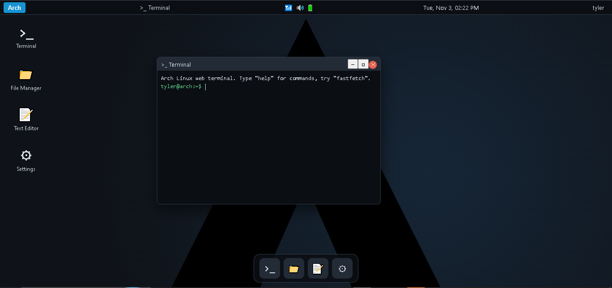

# Arch Linux Web Simulator

A fully interactive Arch Linux desktop that runs entirely in your browser. Built with plain HTML, CSS and JavaScript: no frameworks, no build step, no dependencies.

**[Live demo](https://benreilly222.github.io/ArchLinuxOS-Web-Simulator/)**

> This is a simulation made for learning and fun. It is not a real Linux system, and nothing you do here touches your computer.

## Features

- **Boot sequence** with a systemd-style boot log
- **First-boot setup**: choose your name once, it is remembered in your browser
- **Login screen** (any password works)
- **Animated, blurred wallpaper** with a frosted-glass panel, dock, menus and windows
- **Top panel** with an app menu (with search), task list, tray, clock and user menu (log out, restart, reset)
- **Window manager**: drag, resize, minimize, maximize, close, and correct stacking order
- **Terminal** with a virtual file system and many tools (see below)
- **File Manager** and **Text Editor** that share the same virtual file system: double-click a file to edit it, save it, and see it in the terminal
- **Settings**: accent color, glass blur strength, wallpaper animation on/off, reset account

## Terminal commands

| Category | Commands |
|----------|----------|
| System info | `fastfetch`, `neofetch`, `uname -a`, `uptime`, `free`, `df`, `htop`, `ip`, `hostname`, `whoami`, `date` |
| Files | `ls`, `ls -a`, `cd`, `pwd`, `cat`, `mkdir`, `touch`, `rm`, `echo hello > file.txt` |
| Packages | `pacman -Syu`, `pacman -S <package>`, `pacman -R <package>`, `pacman -Q`, `yay` |
| Network | `ping <host>` |
| Fun and tools | `cowsay`, `fortune`, `calc 2+2*3`, `open <app>` |
| Shell | `help`, `history`, `clear` (or `Ctrl+L`), `exit`, `sudo <command>` |

Use the up and down arrow keys to browse your command history.

## Run locally

1. Download or clone this repository.
2. Open `index.html` in any modern browser.

That is all. The whole simulator is one self-contained file.

## Deploy on GitHub Pages

1. Go to **Settings -> Pages**.
2. Set **Source** to "Deploy from a branch", then choose branch `main` and folder `/ (root)`.
3. Save. Your site goes live at `https://<your-username>.github.io/<repository-name>/`.

## Contributing

Contributions are welcome.

1. Fork the repository.
2. Create a branch for your change.
3. Open a pull request describing what you changed.

Ideas for new features:

- More terminal commands (`grep`, `tree`, `nano`)
- More apps (calculator, system monitor, web browser)
- Wallpaper and theme picker
- Saving the virtual file system in `localStorage`

Found a bug? Please open an issue.

## License

This project is licensed under the MIT License. See the [LICENSE](LICENSE) file for details.
